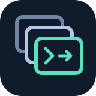
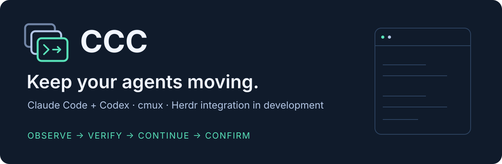

<p align="center"></p>

# CCC · Keep your agents moving

[English](README.md) · [繁體中文](README.zh-TW.md) · [Agent guide](docs/agent-guide.md) · [Support status](docs/herdr.md)



**CCC manages guarded continuation for Claude Code and Codex in cmux on macOS.**
It watches authorized sessions, checks native evidence before acting, and exposes
continuation status in a terminal supervisor. The goal is to recover interrupted
work while preserving the original session and the operator's input.

**Herdr integration is in development. The default installation in `main` does
not yet include the nested Herdr observer/guard.** Experimental builds and local
validation are not a portable release. See [Herdr support and release gates](docs/herdr.md).

## What is available

| Component | In this public branch |
| --- | --- |
| cmux watcher | Claude Code / Codex discovery, explicit enrollment and guarded continuation |
| Supervisor TUI | Workspace/surface inventory, current state, diagnostics and controls |
| Auditing | Session and Hook diagnostics; original identities and delivery evidence |
| Optional utilities | Profile editor, network guard and quarantine-based cleanup |
| Herdr inner panels | Development work; not included in the default installer |
| Other AI agents | Can use the documented CLI; automatic recovery of their own sessions is not claimed |

A sent command is not proof of receipt. Receipt is not proof of useful work.
CCC preserves uncertain delivery instead of blindly replaying input. It cannot
repair an exhausted provider balance or guarantee recovery from every upstream error.

## Start by inspecting

Requirements: macOS 13+, Python 3.10+, and [cmux](https://cmuxterm.app/).
Runtime Python code uses the standard library. The optional access-check mode
requires Python 3.11+. Install Codex and/or Claude Code separately.

```sh
git clone https://github.com/lzhs1995/ccc.git
cd ccc
python3 cmux_codex_watch.py --help
python3 cmux_codex_watch.py status
python3 bin/cmux-stack status --json
```

These commands do not install or arm the watcher. An uninstalled component or
missing cmux connection should be reported as unavailable, not as healthy.

## Install and opt in

Read [the agent guide](docs/agent-guide.md) before installing onto a machine
with existing sessions. **The following command changes local files and
loads/replaces the CCC LaunchAgent. It is not a preview.**

```sh
python3 cmux_codex_watch.py install
```

Fresh installs default to dry-run; Claude continuation is disabled. Existing
installations retain their current configuration. Verify the exact surface UUID,
configure only the targets you intend to manage, then explicitly arm:

```sh
ccc track-surface FULL_SURFACE_UUID --allow-non-codex
ccc status
ccc arm
ccc tui
```

Replace `FULL_SURFACE_UUID` with the verified target, never a title or assumed
focused panel. Claude also needs `claude_enabled: true` in the local configuration
and valid native Hook evidence. See [registration](docs/registration-observation.md),
[Codex Hooks](docs/codex-hooks.md) and [operations](docs/operations.md).
Do not register an outer cmux surface as though it were a particular Herdr inner panel.

## For coding agents

Start at [AGENTS.md](AGENTS.md), then [the agent guide](docs/agent-guide.md).
Commands, side effects, supported agents and acceptance criteria are plain
Markdown; no proprietary integration is required to read them.
[config.example.json](config.example.json) is a reference, not a replacement
for an existing user's configuration.

## Development and publication

- [Contributing and checks](CONTRIBUTING.md)
- [Security and private data](SECURITY.md)
- [Detailed existing feature reference](docs/legacy-reference.md)
- [Network guard](docs/network-guard.md)
- [Changelog](CHANGELOG.md) · [Releases](https://github.com/lzhs1995/ccc/releases)

The public-content check scans the current tracked tree and proposed files for
common credentials, private paths and runtime artifacts. It does not certify
all Git history. Do not upload real sessions or credentials in bug reports.

The SVG logo and banner are original project assets, included under the
[MIT license](LICENSE). This project is independent of cmux, Herdr, OpenAI and Anthropic.
