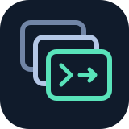
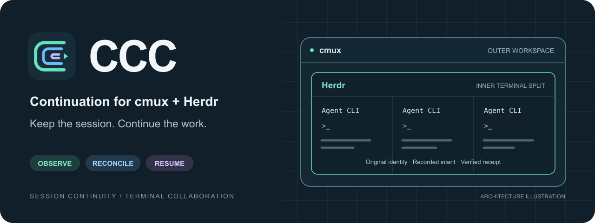

<p align="center"></p>

# CCC · 让你的科研与工程 Agent 持续推进

[English](README.md) · [简体中文](README.zh-CN.md) · [繁體中文](README.zh-TW.md) · [Agent 协作指南](docs/agent-guide.md) · [Herdr 支持说明](docs/herdr.md)

<picture>
  <source srcset="assets/banner.svg" type="image/svg+xml">
  
</picture>

**CCC 在 macOS 上为 `cmux`（及嵌套在 `cmux` 中的多实例 `Herdr`）里的 Codex 与 Claude Code 提供带原生证据门禁的自动续跑守护。**

它只对真实原生终端完成事件与空输入框行动，严守不篡改用户草稿、不跨面板误发、不因单次投递不明而盲目重放的底线，并在终端 Supervisor TUI 中实时展示工作区、网络与抢位状态。

## 核心能力

| 模块 | 功能说明 |
| --- | --- |
| `cmux` 守护器 (`cmux_codex_watch.py`) | Codex / Claude Code 原生事件发现、外层 `a`/`w` 授权与安全自动续跑 |
| `b 空目录 50` | 创建 50 个独立槽位，按原生轮次跟踪重试和就绪状态；实际可用并发取决于供应商和网络 |
| AnyRouter 网络守卫 (`ccc_network_guard.py`) | 监控 Clash Verge / Mihomo `AnyRouter` 自动测速线路，手选节点单次故障立即接替至可达自动节点 |
| 多实例 Herdr 守卫 | 发现默认和命名会话的私有 socket；核实外层隔离、内层终端、前台进程和原生会话后按配置续跑。[安装与回滚](docs/herdr.md) |
| Supervisor TUI (`cmux_supervisor_tui.py`) | 实时区分展示 `就绪`、`抢位续跑` 与 `异常` 槽位，支持一键工作区批处理与暂停/恢复 |

## 快速开始

环境要求：macOS 13+、Python 3.10+（推荐 Python 3.11+）以及 [cmux](https://cmuxterm.app/)。

```sh
git clone https://github.com/lzhs1995/ccc.git
cd ccc
python3 cmux_codex_watch.py --help
python3 cmux_codex_watch.py status
```

安装并启用守护服务（会更新本机 LaunchAgent）：

```sh
python3 cmux_codex_watch.py install
ccc track-surface FULL_SURFACE_UUID
ccc arm
ccc tui
```

## 给编码 Agent 的入口

请先阅读 [AGENTS.md](AGENTS.md) 与 [docs/agent-guide.md](docs/agent-guide.md)。`CLAUDE.md`、`GEMINI.md` 与 [llms.txt](llms.txt) 共享同一份规范。

发布或提交前请务必执行公开内容脱敏与测试检查：

```sh
python3 -B scripts/check_public_content.py
pytest
```

## 许可协议

本项目及原创 [Logo / Banner 视觉资产](docs/branding.md) 采用 [MIT License](LICENSE) 开源。本项目独立于 cmux、Herdr、OpenAI 与 Anthropic。

可从 v3 快照重建原工作区、标签和分屏，核对原生会话标识后在原 pane 启动。先预览 `stage` 结果，再启用 `--auto-enter`。[离线恢复操作](integrations/herdr-restore/README.md)
