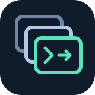
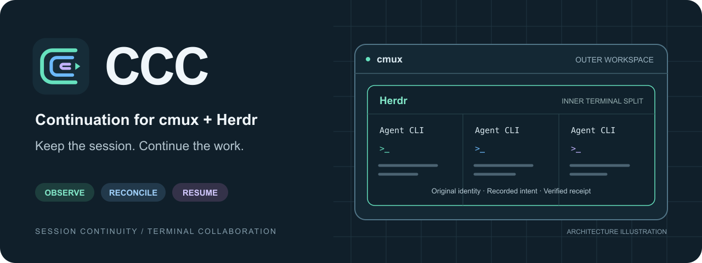

<p align="center"></p>

# CCC · 讓 agent 持續推進任務

[English](README.md) · **繁體中文** · [Agent 操作指南](docs/agent-guide.md) · [Herdr 支援狀態](docs/herdr.md)

<picture>
  <source srcset="assets/banner.svg" type="image/svg+xml">
  
</picture>

此圖為架構示意；Herdr 整合仍在開發。

**CCC 是 macOS 上的 cmux 續跑管理器，支援 Claude Code 與 Codex。**
它觀察已授權的會話，在操作前核對原生證據，並以終端管理介面呈現續跑狀態。
目標是在保留原會話及使用者輸入的前提下，讓中斷的工作繼續推進。

**Herdr 整合仍在開發。目前 `main` 的預設安裝程式尚未包含 Herdr 內部面板的觀察器
與守衛。** 實驗分支及本機驗證不等於可攜式正式發布。詳見
[Herdr 支援範圍與發布條件](docs/herdr.md)。

## 目前提供什麼

| 元件 | 本公開分支的內容 |
| --- | --- |
| cmux 守衛 | 發現 Claude Code／Codex、明確登記目標、依核驗結果續跑 |
| 終端管理介面 | 工作區與 surface 清單、目前狀態、診斷及操作控制 |
| 稽核 | 會話與 Hook 診斷、原始身分及投遞證據 |
| 選用工具 | 設定檔編輯器、網路守衛、先隔離再清理的工具 |
| Herdr 內部面板 | 開發中，尚未納入預設安裝程式 |
| 其他 AI agent | 可以閱讀指南並操作 CLI；不宣稱可自動恢復它們自己的會話 |

送出命令不代表對方收到，收到也不代表任務已有實際進展。CCC 遇到投遞結果不明時
不盲目重送。它不能補足上游帳戶餘額，也無法保證修復所有上游錯誤。

## 先檢查，再操作

需求：macOS 13 以上、Python 3.10 以上，以及 [cmux](https://cmuxterm.app/)。
執行程式只使用 Python 標準函式庫；選用的 API 接入檢查模式需要 Python 3.11 以上。
Codex／Claude Code 請另行安裝。
目前安裝程式預期 cmux 與可寫入的命令別名位於 `/opt/homebrew/bin`；
其他 Homebrew 路徑需另行核對安裝方式。

```sh
git clone https://github.com/lzhs1995/ccc.git
cd ccc
python3 cmux_codex_watch.py --help
python3 cmux_codex_watch.py status
python3 bin/cmux-stack status --json
```

以上命令不會安裝或啟用自動輸入。尚未安裝的元件、無法連線的 cmux，應顯示為不可用，
不能視為健康。

## 安裝與明確啟用

在已有會話的機器上操作前，先讀 [agent 操作指南](docs/agent-guide.md)。
**以下命令會修改本機檔案並載入或替換 CCC LaunchAgent，不是預覽。**

```sh
python3 cmux_codex_watch.py install
```

全新安裝預設為 dry-run，Claude 續跑關閉；既有安裝則保留目前設定。
先核對完整 surface UUID，只登記你要管理的目標，再明確啟用：

```sh
ccc track-surface FULL_SURFACE_UUID
ccc status
ccc arm
ccc tui
```

請將 `FULL_SURFACE_UUID` 換成已核驗的 Codex 目標，不能靠標題或目前焦點猜測。
`arm` 會啟用全域模式並解除全域暫停；請先檢查所有既有登記。
Claude 登記另需 `--allow-non-codex`、本機設定中的 `claude_enabled: true`
及有效原生 Hook 證據。
詳見 [登記與觀察](docs/registration-observation.md)、[Codex Hooks](docs/codex-hooks.md)
及[維運指南](docs/operations.md)。不要把外層 cmux surface 當成某個 Herdr 內部面板登記。

## 給各種 coding agent

從 [AGENTS.md](AGENTS.md) 進入，再讀 [agent 操作指南](docs/agent-guide.md)。
`CLAUDE.md`、`GEMINI.md` 與 [llms.txt](llms.txt) 都指向同一套共用指南。
命令、操作影響、支援範圍、錯誤判讀與驗收標準都以一般 Markdown 提供。
是否自動讀取取決於客戶端；需要時請明確要求它閱讀 `AGENTS.md`。
閱讀文件不會新增其他 agent 的執行階段支援。
[設定範例](config.example.json) 僅供參考，不可覆蓋使用者的既有設定。

## 開發與公開發布

- [貢獻方式與檢查](CONTRIBUTING.md)
- [安全與私人資料](SECURITY.md)
- [原有功能詳細參考](docs/legacy-reference.md)
- [網路守衛](docs/network-guard.md)
- [變更紀錄](CHANGELOG.md) · [版本發布](https://github.com/lzhs1995/ccc/releases)

公開內容檢查涵蓋目前版本及待提交檔案中的常見憑證、私人路徑與執行狀態資料模式，
不等於已認證全部 Git 歷史安全。範例使用假資料；回報問題時請勿上傳真實會話或憑證。

[SVG／PNG Logo 與配圖](docs/branding.md)為本專案原創，適用倉庫的 [MIT 授權](LICENSE)。
本專案獨立於 cmux、Herdr、OpenAI 與 Anthropic。
