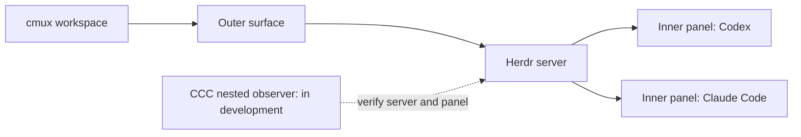

# Herdr support / Herdr 支援狀態

Updated: 2026-11-10. This page describes what a fresh clone of `main` provides.

**The default CCC installer currently manages direct cmux sessions. It does not
install the experimental Herdr observer, nested-panel guard or its paired
native-reader dependencies.** Do not present a development workflow artifact as
an installable Herdr release.

CCC's direction is one supervisor for direct cmux sessions and agents running
inside [Herdr](https://github.com/herdrdev/herdr). Experimental branches and local
implementations still need a portable release and independent live acceptance.
Existing public commands must not be assumed to select an inner Herdr panel.

## Why an outer surface is insufficient

A cmux surface may host one Herdr process containing several agent terminals.
Outer focus, an agent title, or a reported startup session ID cannot prove which
inner agent currently owns the input. Sending to that outer surface can type
into the wrong agent or leave a draft.

## Requirements for the portable integration

- Discover each endpoint and inner panel without trusting focus or title.
- Bind server process, panel, terminal and current selected native session.
- Keep observation separate from input authorization; preserve user drafts,
  dialogs, paused/completed goals and uncertain delivery.
- Use one original controller and durable attempt ledger for each recovery.
- Confirm the original session received the action, then observe useful work
  or a renewed failure. A Goal-start receipt is not an ordinary message.
- Publish measured recovery latency across the whole fleet. UI labels and
  configured polling intervals are not timing measurements.
- Package dependencies, sanitized examples, install and rollback procedures
  that work without the maintainer's home directory.
- Validate repeated real error → continuation → useful-work cycles, not just
  one fixture or one successful start. Preserve existing agents during adoption.

These are release gates, not claims that all are satisfied today. A documentation
update alone does not finish Herdr recovery or fix provider errors.

## Current user guidance

Use the existing cmux installation only for verified direct agent surfaces.
If you already run a local Herdr guard, retain its original controller,
configuration and evidence; do not replace it with `main` or an arbitrary build.
Report sanitized endpoint/panel structure, software versions and timestamps.
Do not publish full transcripts, private sockets or tokens.

## 繁體中文

截至上列日期，從 `main` 全新安裝只能取得直接管理 cmux 會話的工具，**尚未包含
Herdr 內部面板守衛及配套原生讀取依賴**。外層 surface 內可以有多個 agent，
不能依焦點、標題或啟動時的會話 ID 決定輸入目標。

公開版必須完成逐面板身分核驗、草稿保護、原投遞紀錄保留、真實收件及工作確認、
全體面板延遲量測，以及不依賴私人路徑的安裝與回復流程。還要驗證多次出錯後都能
恢復。這些是發布條件，不是已完成聲明。已有本機 Herdr 守衛時，請保留原設定，
不要用目前主分支或任意實驗工件覆蓋。
